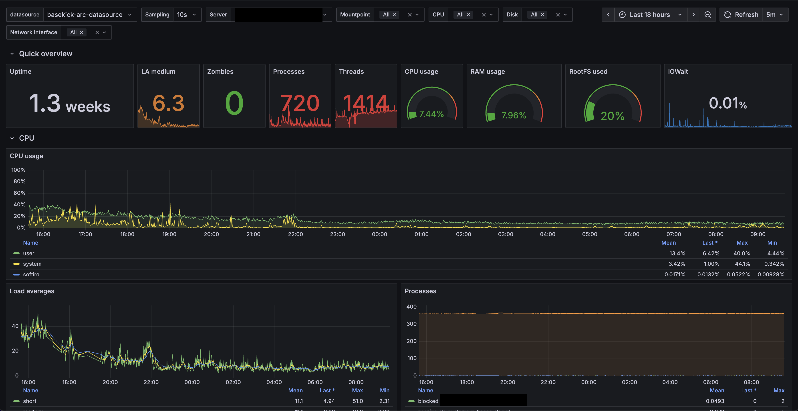
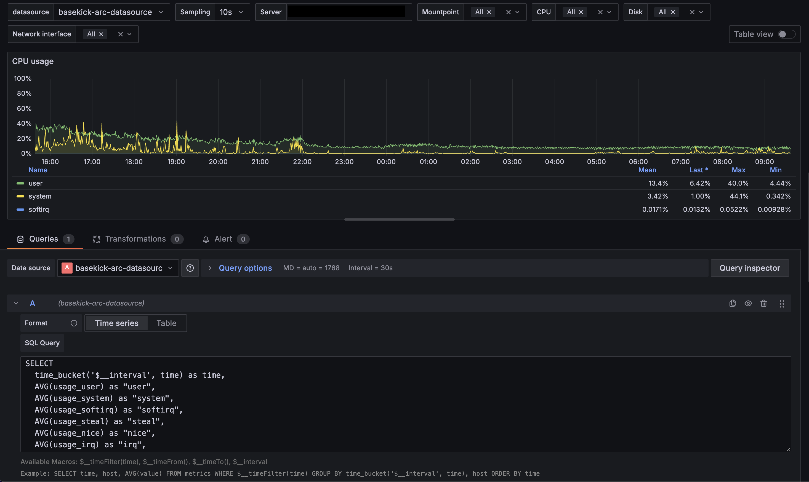
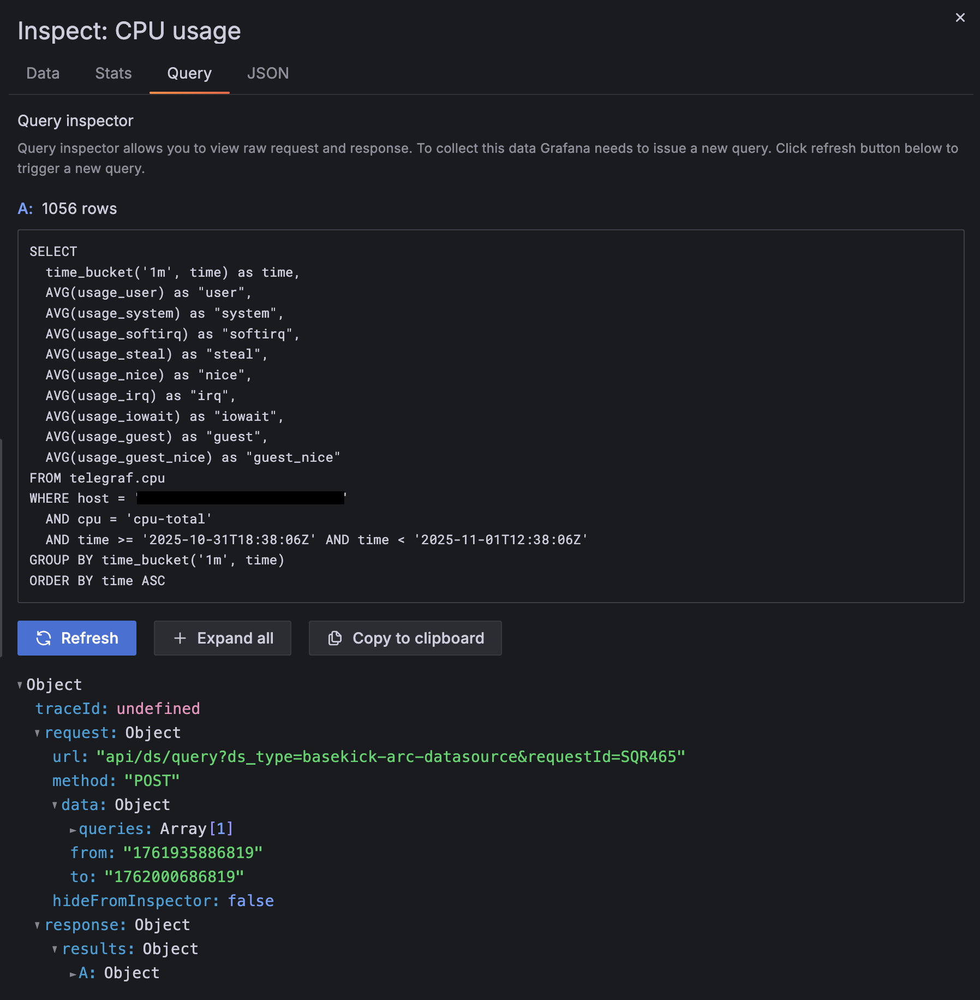
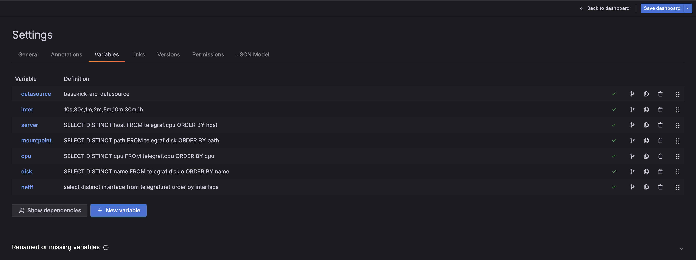
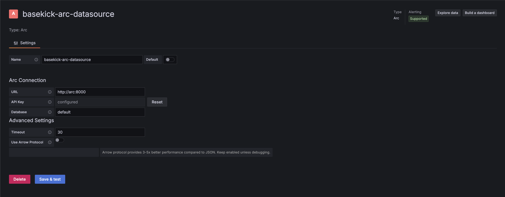
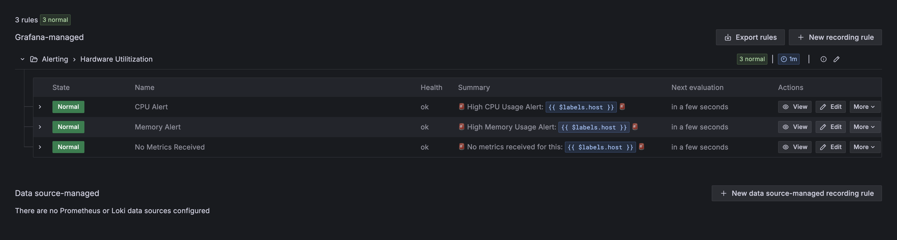

# Arc Datasource for Grafana

High-performance Grafana datasource plugin for Arc time-series database using Apache Arrow for efficient data transfer.

## Screenshots

### Dashboard with Real-time Monitoring


### Query Editor


### Data Inspector


### Variable Configuration


### Datasource Configuration


### Alerting


## Features

- **Three wire protocols**: Apache Arrow IPC (default, fastest), columnar MessagePack (stable since Arc 26.09.1), and JSON (compatibility fallback)
- **High Performance**: Streaming deserialization straight into Grafana DataFrames
- **Query Splitting**: Large time ranges chunked and executed in parallel, with automatic skip for queries where splitting would change results
- **Alerting Support**: Full support for Grafana alerting and notifications
- **Visual Query Builder**: InfluxQL-style rows (FROM, WHERE, SELECT, GROUP BY) that write Arc SQL, with database, measurement, column and value suggestions from Arc
- **SQL Query Editor**: Direct DuckDB SQL with Grafana macro expansion
- **Template Variables**: Dynamic dashboard filters with variable support
- **Time-series Optimized**: Native support for DuckDB time functions
- **Multi-database**: Query across different Arc databases/schemas (opt-in per-query override)
- **Secure**: API key authentication with secure credential storage, SSRF-guarded outbound connections

## Performance

Real-world performance characteristics:
- **Data processing**: typically sub-millisecond per chunk for time-series conversion
- **Query execution**: dominated by Arc server (typically 100-500ms)
- **Columnar transfer**: Arrow IPC streamed from Arc, decoded into Grafana DataFrames
- **Optimized sorting**: O(n log n) time-series sorting when post-sort is needed

## Installation

### From Release

1. Download the latest release from GitHub releases
2. Extract to your Grafana plugins directory:
   ```bash
   unzip grafana-arc-datasource-<version>.zip -d /var/lib/grafana/plugins/
   ```
3. Restart Grafana:
   ```bash
   systemctl restart grafana-server
   ```

### From Source

```bash
# Clone repository
git clone https://github.com/basekick-labs/grafana-arc-datasource
cd grafana-arc-datasource

# Install dependencies
npm install

# Build plugin
npm run build

# Build backend
mage -v

# Install to Grafana
cp -r dist /var/lib/grafana/plugins/grafana-arc-datasource
systemctl restart grafana-server
```

## Configuration

1. In Grafana, go to **Configuration** → **Data sources**
2. Click **Add data source**
3. Search for and select **Arc**
4. Configure connection:
   - **URL**: Arc API endpoint (e.g., `http://localhost:8000`)
   - **API Key**: Your Arc authentication token
   - **Database** (optional): Default database/schema
5. Click **Save & Test**

### Configuration Options

| Option | Description | Required | Default |
|--------|-------------|----------|---------|
| URL | Arc API base URL | Yes | - |
| API Key | Authentication token | Yes | - |
| Database | Default database name | No | `default` |
| Timeout | Query timeout in seconds | No | `30` |
| Protocol | Query response wire format: `Arrow` (fastest, recommended), `MessagePack`, or `JSON` | No | `Arrow` |
| Max Concurrency | Parallel chunks within a single split query | No | `4` |
| Max In Flight | Simultaneous Arc requests for this datasource, across all panels | No | `32` |
| Max Response MB | Per-response body size cap in MiB | No | `1024` |
| Allow Private IPs | Permit the Arc URL to resolve to private/RFC1918 addresses | No | on |
| Allow Database Override | Permit per-query `database` field to override the default | No | on |

**Allow Private IPs** is on because self-hosted Arc usually runs on a private
network or a Docker service name such as `http://arc:8000`. Turn it off to
require a public address. Link-local and cloud-metadata addresses (including
`169.254.169.254`) are blocked either way.

**Allow Database Override** is on, matching the per-query override supported
since 1.1.0. Turn it off when the API key reaches more databases than
dashboard editors should.

### Choosing a protocol

- **Arrow** decodes Arc's Arrow IPC stream directly and is the fastest option; keep it unless you have a reason not to.
- **MessagePack** uses Arc's columnar `/api/v1/query/msgpack` endpoint (stable since Arc 26.09.1). It reaches roughly 78% of Arrow's decode throughput and additionally supports gzip response compression, which can help on constrained links.
- **JSON** is the slowest path and exists for compatibility and debugging.

## Usage

### Query Builder

New queries open in a visual builder modelled on Grafana's InfluxDB (InfluxQL) editor. Every change writes Arc SQL, shown under the rows; that SQL is what Arc runs, so panels, Explore and alerts all behave like a query you typed yourself.

```
FROM     [database] [measurement]   WHERE  [column] [operator] [value]  +
SELECT   [function] [column] [transformation] [math] AS [alias]          +
GROUP BY time([interval]) [tag]                                          +
ORDER BY time [ASC|DESC]   LIMIT [n]
```

| Row | What it writes |
|-----|----------------|
| **FROM** | `FROM "measurement"`, always with `WHERE $__timeFilter(time)`. The database list comes from Arc (a key that can read only one database sees that one); the database picker is hidden when **Allow Database Override** is off. |
| **WHERE** | AND-joined filters. Text columns get `=`, `!=`, `=~`, `!~`, `LIKE`, `NOT LIKE`; numbers get comparisons; all get `IS NULL`. Value suggestions are the distinct values in the panel's time range, narrowed by the other filters. |
| **SELECT** | `mean`, `median`, `sum`, `count`, `count distinct`, `min`, `max`, `first`, `last` (earliest/latest by time), `stddev`, `spread`, `percentile`, `count rows`, or `raw` (no aggregation). Then optionally a transformation and math (below). Aliases default to the function name (or the transformation's), as in InfluxQL; a repeated default gets `_1`, `_2`. |
| **GROUP BY** | `time($__interval)` (or a fixed interval) and tag columns. Each tag set becomes its own series. |

Arc keeps no tag/field marker, so the builder goes by column type: text columns are offered for filters and GROUP BY, numeric ones for aggregation. Columns come from Arc's stored schema; a measurement written before Arc kept one gets its columns from its last 24 hours of data (marked "inferred").

**Variables.** Every dropdown offers the dashboard's variables:
- A filter on `=` or `!=` turns a variable into `IN (…)` / `NOT IN (…)`, so multi-value and **All** selections work. Other operators accept single-value variables only.
- A variable with a custom **All** value cannot be used in a builder filter: switch the query to Code.
- A database or measurement variable must have exactly one value selected.
- Alert rules are evaluated without dashboard variables. **New alert rule** from a builder panel stores the SQL with the variables' current values, in Code mode.

**Semantics worth knowing:**
- `!=`, `!~` and `NOT LIKE` keep rows where the column is NULL, matching InfluxQL, where a negated tag filter keeps series that lack the tag.
- Regular expressions use DuckDB's RE2 syntax; InfluxQL-style `/…/` delimiters are accepted.
- A value containing `$` is substituted by Grafana like a variable.
- A LIMIT, or a window function (`OVER`) in Code mode, turns off query splitting for that query.
- Arc refuses SQL longer than `query.max_sql_length` (10,000 characters by default). An **All** selection over many values can exceed it; the panel then says so.

**Transformations.** A field can be followed by an InfluxQL transformation, computed per series in time order:

| Transformation | Value |
|---|---|
| `derivative(unit)` | rate of change per unit (default `1s`; e.g. `10s`, `500ms`), over the actual time between values |
| `non_negative_derivative(unit)` | the same, with negative rates dropped: a counter reset is not a dip |
| `difference` / `non_negative_difference` | change from the previous value |
| `moving_average(n)` | mean of the last n values |
| `cumulative_sum` | running total from the start of the range |

A Telegraf counter panel is `max(bytes_recv)` → `non_negative_derivative` `1s`, grouped by `time($__interval)` and `host`. The results match InfluxDB 1.8's for the same data:
- NULL buckets are skipped.
- The range's first bucket has a value, computed from the bucket before it.
- A point with no value (a series' first, a counter reset) is dropped.

Transformations need values in time order: `GROUP BY time`, or a raw time series. Such a query is never split; the editor says so next to **Splitting**.

**Math.** After the function (and transformation), a chain such as `* 8` or `/ 1024 / 1024`, applied left to right. It cannot mix `+`/`-` with `*`/`/`: use Code for that.

**Builder and Code.** **Edit as SQL** (or the **Code** toggle) switches to the SQL editor with the builder's SQL. Going back to **Builder** asks first: code changes are not carried into the builder, which reopens its last state. Queries saved before the builder existed, and any query whose SQL was edited outside the builder, open in Code unchanged.

Not in the builder yet (use Code): `fill()`, `OR` and grouped filters, math between fields, and `GROUP BY *`.

### Query Editor (Code)

The Arc datasource provides a SQL query editor with:
- Time range macros expanded server-side (safe against injection via literals/comments)
- Result format selection (time series or table)
- Query splitting controls and per-query database override

#### Example Queries

**Basic time-series query (CPU usage):**
```sql
SELECT
  $__timeGroup(time, '$__interval') AS time,
  AVG(usage_idle) * -1 + 100 AS cpu_usage,
  host
FROM telegraf.cpu
WHERE cpu = 'cpu-total'
  AND $__timeFilter(time)
GROUP BY 1, host
ORDER BY 1 ASC
```

**Memory usage:**
```sql
SELECT
  $__timeGroup(time, '$__interval') AS time,
  AVG(used_percent) AS memory_used,
  host
FROM telegraf.mem
WHERE $__timeFilter(time)
GROUP BY 1, host
ORDER BY 1 ASC
```

**Network traffic (bytes to bits):**
```sql
SELECT
  $__timeGroup(time, '$__interval') AS time,
  AVG(bytes_recv) * 8 AS bits_in,
  host,
  interface
FROM telegraf.net
WHERE $__timeFilter(time)
GROUP BY 1, host, interface
ORDER BY 1 ASC
```

> Prefer `$__timeGroup` over raw `time_bucket`/`date_trunc` for bucketing:
> DuckDB's `date_trunc` retains nanosecond residuals on `TIMESTAMP_NS`
> columns, which makes `GROUP BY` produce per-second rows. The macro expands
> to integer epoch math that avoids this.

### Macros

The datasource provides several macros for dynamic queries:

| Macro | Description | Example |
|-------|-------------|---------|
| `$__timeFilter(columnName)` | Complete time range filter | `WHERE $__timeFilter(time)` |
| `$__timeFrom()` | Start of time range | `time >= $__timeFrom()` |
| `$__timeTo()` | End of time range | `time < $__timeTo()` |
| `$__interval` | Grafana's calculated interval | `$__timeGroup(time, '$__interval')` |
| `$__timeGroup(columnName, interval[, fill])` | Epoch-based time bucketing. The interval is `<n><unit>`: `s`, `m`, `h`, `d`, `w`, or `ms`, which rounds up to whole seconds (`500ms` buckets by 1s). The optional `fill` fills empty buckets: see below | `$__timeGroup(time, '1m', NULL) AS time` |
| `$__timeFilterLookback(columnName, interval, n)` | Like `$__timeFilter`, starting `n` buckets before the bucket that holds the range start | `WHERE $__timeFilterLookback(time, '5m', 1)` |
| `$__timeGroupStart(interval)` | The start of the bucket that holds the range start | `QUALIFY "time" >= $__timeGroupStart('5m')` |

#### Filling gaps

A third `$__timeGroup` argument gives every series a point in every bucket of the range, as in Grafana's Postgres and MySQL datasources:

| Fill | Empty bucket, or NULL value, gets |
|---|---|
| `NULL` | null: the panel shows a gap |
| `previous` | the series' previous value (nothing before its first) |
| `linear` | a value interpolated by time between its neighbours (ends stay empty) |
| a number, e.g. `0` | that number |

```sql
SELECT $__timeGroup(time, $__interval, 0) AS "time", host, count(*) AS errors
FROM logs WHERE $__timeFilter(time) AND level = 'error'
GROUP BY 1, 2
```

- **Time series format only.** Tables are not filled.
- **Done by the plugin, not Arc:** the SQL is the same with or without it, and the filled points are not stored anywhere.
- **The plugin leaves the result unfilled, with a notice, when:**
  - the result is incomplete (Arc's row cap, or a dropped query chunk);
  - the query has more than one `$__timeGroup`;
  - the rows are not the macro's buckets;
  - the range holds more than 1,000,000 bucket-and-series points.
- **Migrated dashboards:** before this release the third argument was accepted and ignored, so a panel migrated from Postgres with `$__timeGroup(time, '5m', 0)` drew no zeros. It now fills. Remove the argument to keep the old drawing.

### Variables

Create dashboard variables to make queries dynamic:

**Host variable:**
```sql
SELECT DISTINCT host FROM telegraf.cpu ORDER BY host
```

**Interface variable:**
```sql
SELECT DISTINCT interface FROM telegraf.net ORDER BY interface
```

Use variables in queries with `$variable` syntax:
```sql
SELECT
  time_bucket(INTERVAL '$__interval', time) as time,
  AVG(usage_idle) * -1 + 100 AS cpu_usage
FROM telegraf.cpu
WHERE host = '$server'
  AND cpu = 'cpu-total'
  AND $__timeFilter(time)
GROUP BY time_bucket(INTERVAL '$__interval', time)
ORDER BY time ASC
```

#### Quoting rules

This plugin follows the same rule as Grafana's built-in SQL datasources
(Postgres, MySQL, MSSQL), so queries port between them unchanged:

| Variable kind | What the plugin does | How to write it |
|---|---|---|
| Single-value | Escapes embedded quotes; adds **no** quotes | You supply the quotes: `WHERE host = '$server'` |
| Multi-value or "Include All" | Quotes **each** value and joins with commas | Leave it bare: `WHERE host IN ($servers)` |

The practical consequences:

- A single-value variable works inside a literal of any shape, including a
  regex: `WHERE host ~ '^$server$'`.
- A multi-value variable must **not** be wrapped in quotes — `'$servers'`
  would produce `''a','b''`. Use `IN ($servers)`, or `${servers:raw}` if you
  need to place the values yourself.
- Grafana's own macros (`$__interval`, `$__from`, `$__to`) are single-value,
  so `INTERVAL '$__interval'` is correct.

Embedded single quotes are always doubled, so a value cannot terminate the
literal it is placed in. Two cases are outside that guarantee, both identical
to Grafana's built-in SQL datasources:

- A variable used **without** quotes (`WHERE host = $server`) is interpolated
  as-is.
- A variable inside a DuckDB **escape-string** literal (`WHERE host =
  E'$server'`), where a backslash in the value can consume the closing quote.
  Use a standard `'...'` literal instead.

Both are reasons to scope Arc's API key to what the dashboard's viewers are
allowed to read.

### Alerting

The datasource fully supports Grafana alerting. A rule built from a query whose result can hold NULL values (a `fill(NULL)`, or several transformed fields in one query) reduces to NaN in a Reduce expression's default Strict mode; set its mode to **Drop non-numeric values**. Create alert rules with Arc queries:

**Example alert query (CPU usage > 80%):**
```sql
SELECT
  time,
  100 - usage_idle AS cpu_usage,
  host
FROM telegraf.cpu
WHERE cpu = 'cpu-total'
  AND time >= NOW() - INTERVAL '5 minutes'
ORDER BY time ASC
```

Then set alert condition: `WHEN avg() OF query(A, 5m, now) IS ABOVE 80`

## Development

### Prerequisites

- Node.js 22+
- Go 1.26+
- Mage (Go build tool)
- Grafana 12.3+

### Setup

```bash
# Install dependencies
npm install

# Install Go dependencies
go mod download

# Frontend bundle (watch mode)
npm run dev

# Backend binary for the current platform
mage -v build:linux

# Local Grafana with the plugin mounted
docker compose up
```

### Project Structure

```
grafana-arc-datasource/
├── src/
│   ├── datasource.ts       # Main datasource implementation
│   ├── ConfigEditor.tsx    # Configuration UI
│   ├── QueryEditor.tsx     # Query editor UI
│   ├── VariableQueryEditor.tsx
│   ├── module.ts           # Plugin entry point
│   └── plugin.json         # Plugin metadata
├── pkg/
│   ├── plugin/
│   │   ├── datasource.go   # Backend datasource
│   │   ├── query.go        # Query handling
│   │   └── arrow.go        # Arrow protocol implementation
│   └── main.go
├── package.json
├── go.mod
└── README.md
```

### Testing

```bash
# Frontend tests
npm run test

# Backend tests
go test ./pkg/...

# E2E tests
npm run e2e
```

## Architecture

### Data Flow

```
Grafana Dashboard
  ↓
Query Request (SQL)
  ↓
Frontend (TypeScript)
  ↓
Backend (Go)
  ↓
Arc API (/api/v1/query/arrow, /api/v1/query/msgpack, or /api/v1/query)
  ↓
Columnar Response (Arrow IPC / MessagePack / JSON)
  ↓
Streaming Decoder (Go)
  ↓
Grafana DataFrame
  ↓
Visualization
```

### Wire Protocols

Regardless of protocol, the flow is the same:

1. **Query Submission**: SQL query sent to Arc with time range macros expanded
2. **Columnar Response**: Arc returns the result in the configured wire format
3. **Streaming Decode**: The backend decodes the response incrementally
4. **DataFrame Conversion**: Columns land in Grafana DataFrames with identical field types across all three protocols
5. **Rendering**: Grafana visualizes data

Benefits of the binary formats (Arrow, MessagePack) over JSON:
- No JSON serialization/deserialization overhead
- Columnar layout well-suited for time-series
- Typed data transfer, no string-based type inference

## Troubleshooting

### Connection Issues

**Error: "Failed to connect to Arc"**
- Verify Arc is running: `curl http://localhost:8000/health`
- Check URL in datasource configuration
- Verify network connectivity

**Error: "Authentication failed"**
- Verify API key is valid
- Check token hasn't expired
- Ensure token has read permissions

### Query Issues

**Error: "Table not found"**
- Run `SHOW TABLES` to list available tables
- Verify database name is correct
- Check Arc has data for the measurement

**Slow queries:**
- Add `LIMIT` clause to limit result size
- Use time range filters with `$__timeFilter()`
- Add appropriate indexes in Arc
- Check Arc query performance with `EXPLAIN`

### Plugin Issues

**Plugin not appearing in Grafana:**
- Check plugin directory permissions
- Verify `plugin.json` is valid
- Restart Grafana after installation
- Check Grafana logs: `/var/log/grafana/grafana.log`

**Backend plugin not working:**
- Ensure backend binary is compiled: `mage -v`
- Check binary has execute permissions
- Verify Go version compatibility

## Performance Tips

1. **Keep the Arrow protocol**: Arrow is the default and the fastest transfer format; MessagePack is a close second, JSON the slowest
2. **Optimize time ranges**: Smaller time ranges mean faster queries. Use Grafana's time picker to narrow down your analysis
3. **Leverage $__timeGroup**: Bucket with `$__timeGroup(time, '$__interval')` to avoid returning millions of points. Grafana automatically adjusts `$__interval` based on your dashboard width
4. **Index your time column**: Arc automatically indexes time columns, but ensure your queries filter by time first for optimal performance
5. **Enable caching**: Configure Grafana query caching for frequently accessed data

## Contributing

Contributions welcome! Please see [CONTRIBUTING.md](https://github.com/basekick-labs/grafana-arc-datasource/blob/main/CONTRIBUTING.md) for guidelines.

### Building a Release

```bash
# Build frontend, then backend binaries for all platforms into dist/
npm run build
mage -v buildAll
```

Releases are cut by pushing a `v*` tag; the GitHub Actions release workflow builds, packages, and validates the plugin archive.

## License

Apache License 2.0 - see [LICENSE](https://github.com/basekick-labs/grafana-arc-datasource/blob/main/LICENSE)

## Support

- GitHub Issues: https://github.com/basekick-labs/grafana-arc-datasource/issues
- Arc Documentation: https://docs.basekick.net/arc
- Grafana Plugin Development: https://grafana.com/docs/grafana/latest/developers/plugins/

## Related Projects

- [Arc](https://github.com/basekick-labs/arc) - High-performance time-series database
- [Telegraf Arc Output](https://github.com/basekick-labs/telegraf) - Telegraf output plugin for Arc
- [arc-superset-arrow](https://pypi.org/project/arc-superset-arrow/) - Apache Superset dialect for Arc

---

Built with ❤️ by [Basekick Labs](https://github.com/basekick-labs)
